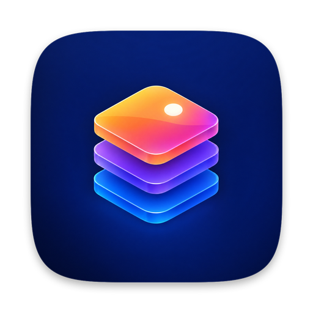
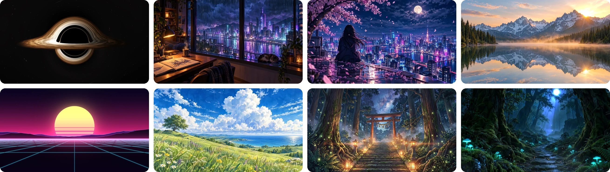
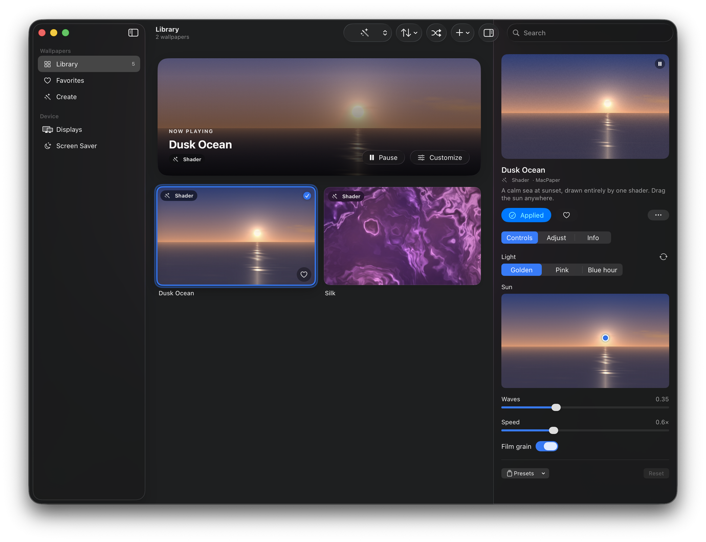

<div align="center">



# MacPaper Engine

**Live wallpapers for macOS, rendered with Metal.**<br>
Video, shaders, particles and depth-parallax images on your desktop and in the screen saver,<br>
in an open package format you can write by hand, with an AI, or generate from any clip.

[](#requirements)
[](Package.swift)
[](Sources/MacPaper/Render)
[](LICENSE)

<br>



<sub>Some of the wallpapers that ship with the app — see <a href="#bundled-wallpapers">Bundled wallpapers</a>.</sub>

</div>

<br>

<p align="center">
  
</p>

## Contents

- [Install](#install) · [with an AI agent](#install-with-an-ai-agent) · [by hand](#install-by-hand)
- [What it does](#what-it-does)
- [Using it](#using-it)
- [Bundled wallpapers](#bundled-wallpapers)
- [Making wallpapers](#making-wallpapers)
- [The `.macpaper` format](#the-macpaper-format)
- [Command line & URL scheme](#command-line--url-scheme)
- [Performance](#performance)
- [Privacy & files](#privacy--files)
- [Project layout](#project-layout)
- [Uninstall](#uninstall)

## Install

### Requirements

| | |
|---|---|
| macOS | 26 Tahoe or later |
| Toolchain | Swift 6.2+ — the Xcode Command Line Tools are enough (`xcode-select --install`); full Xcode is not needed |
| Hardware | Any Mac that runs macOS 26; developed on Apple silicon |
| Optional | [`ffmpeg`](https://formulae.brew.sh/formula/ffmpeg) — only to import WebM / MKV clips in Create |

There is no prebuilt download: the app builds from source in a minute or two and is ad-hoc signed on your Mac.

### Install with an AI agent

Paste this into Claude Code, Codex, Cursor or any agent that can run shell commands on your Mac:

```text
Install MacPaper Engine (https://github.com/adilkairolla/macpaper-engine) on this Mac.

1. Check prerequisites:
   - `sw_vers -productVersion` must be 26 or later. If it is lower, stop and tell me.
   - `swift --version` must report Swift 6.2 or later. If Swift is missing, run
     `xcode-select --install`, wait for me to finish the installer dialog, then re-check.
2. Clone the repository into ~/Developer/macpaper-engine (create ~/Developer if needed;
   if the folder already exists, `git pull` instead of cloning).
3. In that folder run `./scripts/bundle.sh`. It builds a release app into build/MacPaper.app
   (takes 1–3 minutes). If it fails, show me the first error and stop.
4. If MacPaper is running, quit it: `osascript -e 'quit app "MacPaper"'`.
5. Copy the app: `ditto build/MacPaper.app /Applications/MacPaper.app`
   (replace an older copy if present).
6. Launch it: `open /Applications/MacPaper.app`.
7. Ask me whether I want WebM/MKV import; if yes and Homebrew is installed, run `brew install ffmpeg`.
8. Tell me it's done, and that I can install the screen saver from the app's Screen Saver page and
   turn on "Launch at login" in MacPaper › Settings.

Do not change any other system settings.
```

### Install by hand

```sh
git clone https://github.com/adilkairolla/macpaper-engine.git
cd macpaper-engine
./scripts/bundle.sh                              # → build/MacPaper.app (screen saver inside)
ditto build/MacPaper.app /Applications/MacPaper.app
open /Applications/MacPaper.app
```

To update: `git pull`, run `./scripts/bundle.sh` again, quit MacPaper and copy the new build over the old one.
The app's Screen Saver page offers to update the installed screen saver when the bundled one is newer.

## What it does

| | |
|---|---|
| **Wallpaper types** | HEVC / H.264 video (with alpha), still images with a depth map that shift as you move the pointer, Metal shaders, GPU particles (snow, rain, fireflies, embers, bokeh, petals …) — or any stack of them as a layered scene. |
| **Controls** | Each wallpaper declares its own knobs — toggles, sliders, colors, choices, image galleries, a draggable point. The app draws them natively; ones the package marks as quick also appear in the menu bar. Save combinations as presets. |
| **Rotation** | Any choice can change on its own: every N minutes, or each time a clip ends — in order or shuffled, skipping options you exclude. |
| **Displays** | The same wallpaper everywhere or a different one per display. Choose what each display keeps in view when its shape differs from the wallpaper's, or show the whole picture with bars. |
| **Adjust** | Per wallpaper: speed, frame rate, brightness, contrast, saturation, warmth, parallax strength, volume. |
| **Playlists** | Named sets of wallpapers that play one after another — each video once through (short loops for at least 3 minutes), or for a set time — in order or shuffled, on the desktop or in the screen saver. |
| **Reactions** | A character can react to you: a short clip when you unlock, come back, click the desktop, at a set time or now and then, fading back into the loop. |
| **Spanning** | One picture across all your displays, lined up the way they're arranged. |
| **Screen saver** | A real `.saver` that plays any wallpaper live with your settings — the current one, a chosen one, a playlist, or a shuffle of your favorites or library. |
| **Freeze guard** | Checks every few seconds that each display's wallpaper is still moving, and repairs one that isn't. |
| **Sound** | Videos and scenes can carry audio (muted by default). Optionally, wallpapers react to the music playing on your Mac. |
| **Captions** | A wallpaper can give a character lines that appear as they make an entrance, hold a pose or idle — in several languages. |
| **Desktop picture** | Keeps a still frame of each wallpaper as the regular macOS desktop picture, so Mission Control, the login screen and the menu bar tint match. |

## Using it

- **Apply** — double-click a wallpaper, press <kbd>⌘</kbd><kbd>↩</kbd>, or use **Apply** in the inspector. With different wallpapers per display, Apply targets the display the MacPaper window is on; the arrow next to it picks another display or all of them.
- **Customize** — the inspector has three tabs: **Controls** (the wallpaper's own knobs), **Adjust** (framing, motion, color, sound) and **Info** (details, validation, live frame rate).
- **Playlists** — **New Playlist** in the sidebar, then pick wallpapers (search by tag, then **Select All Shown**). Drag to reorder, double-click to play from one. Picking a wallpaper by hand stops the playlist on that display.
- **Menu bar** — pause, mute, shuffle (next, while a playlist plays), recent wallpapers and the wallpaper's quick controls, without opening the window.
- **Undo** — applying, shuffling, deleting and resetting can all be undone with <kbd>⌘</kbd><kbd>Z</kbd>. Deleted packages go to the Trash, and Undo brings them back with their settings.

| Shortcut | |
|---|---|
| <kbd>⌘</kbd><kbd>↩</kbd> · <kbd>↩</kbd> in the grid | Apply the selected wallpaper |
| <kbd>←</kbd> <kbd>→</kbd> <kbd>↑</kbd> <kbd>↓</kbd> | Move through the library |
| <kbd>⌘</kbd><kbd>D</kbd> | Add to / remove from Favorites |
| <kbd>⌘</kbd><kbd>⌫</kbd> in the grid | Move to Trash (undoable) |
| <kbd>⇧</kbd><kbd>⌘</kbd><kbd>P</kbd> | Pause / resume all wallpapers |
| <kbd>⇧</kbd><kbd>⌘</kbd><kbd>R</kbd> | Shuffle |
| <kbd>⌥</kbd><kbd>⌘</kbd><kbd>→</kbd> | Next wallpaper in the playing playlist |
| <kbd>⌥</kbd><kbd>⌘</kbd><kbd>N</kbd> | New playlist |
| <kbd>⌥</kbd><kbd>⌘</kbd><kbd>I</kbd> | Show / hide the inspector |
| <kbd>⌘</kbd><kbd>N</kbd> · <kbd>⌘</kbd><kbd>O</kbd> | New wallpaper from a video or image · Import a package |

## Bundled wallpapers

Twelve wallpapers are installed on first launch, and new ones arrive with updates. Each is an ordinary package in [`Samples/`](Samples): open one to see how it's built.

| Wallpaper | How it's made | What moves |
|---|---|---|
| Event Horizon | Ray-traced shader | Light bends around a black hole; the accretion disk orbits, brighter on the side spinning toward you |
| Outrun | Shader | An endless synthwave drive; the sun and grid pulse with the bass |
| Rainy Night Room | Anime cinemagraph | Rain only on the window glass, city lights flickering, steam from the cup |
| Sakura Rooftop | Anime cinemagraph | Petals drifting, clouds churning around the moon, city lights flickering |
| Summer Sky | Anime cinemagraph | Towering clouds churning, gusts rolling through the grass |
| Lantern Shrine | Anime cinemagraph | Lanterns breathing, fireflies, stars twinkling over the torii |
| Firefly Forest · Snow Cabin · Alpine Dawn | Still + depth map | Parallax depth with fireflies, snow, light rays and mist |
| Dusk Ocean · Northern Lights · Silk | Shaders and particles | Procedural sea, aurora and silk |

In a cinemagraph only masked parts of the picture move, driven by small shaders (billowing clouds, wind, rain on glass, flickering lights, steam), so they never repeat visibly. The scenes were made with GPT Image 2.5 and Nano Banana 2.1 (stills, depth maps and masks), then built into packages by hand. Like everything here, they're MIT-licensed.

## Making wallpapers

**From a clip or picture.** Drop videos or an image on the window (or <kbd>⌘</kbd><kbd>N</kbd>). Create:

- transcodes to HEVC, and can crossfade the end of a clip into its start so it loops without a seam;
- turns several videos into one wallpaper with a gallery to switch between them;
- estimates depth for a still image (Vision subject segmentation) so it moves in parallax;
- adds effects you can paint a mask for: Rain on Glass, Water, Light Rays, Heat Haze, Fog, Drifting Clouds, Aurora, Lightning, Bloom, Day & Night, Music Pulse, Vignette, Film Grain, and particle layers.

AI video tools work well here: generate a still at your display's aspect ratio, then image-to-video with the same image as first and last frame — the clip loops with no seam.

**By hand or with an AI.** A wallpaper is a folder of plain files. Start one from a template, keep it where it is, and every save reloads live on your desktop:

```sh
MacPaper new ~/Walls/Nebula.macpaper --template shader      # or: video, image
open "macpaper://link?path=$HOME/Walls/Nebula.macpaper"   # use it in place; edits reload live
```

**Copy AI Guide** (in the Help menu, and per wallpaper under Info) puts [FORMAT.md](FORMAT.md) plus the wallpaper's manifest on the clipboard — paste it into any chat model and ask for changes.

## The `.macpaper` format

A folder that Finder shows as one file. Everything the wallpaper needs is inside; everything you choose (control values, crop, volume) stays in the app and is never written back.

```text
Koi Dusk.macpaper/
├── manifest.json          layers, controls, canvas, frame rate
├── poster.heic            frame 0 — painted instantly, then live playback takes over
├── media/base.mov
├── images/plate.heic  ·  images/plate-depth.png
└── shaders/ripple.metal
```

```json
{
  "format": 1,
  "id": "4D0E5E8C-6B4B-4F59-9C5F-2C1D3A0E9B11",
  "title": "Koi Dusk",
  "canvas": { "width": 3840, "height": 2160 },
  "layers": [
    { "id": "base",  "type": "video",     "src": "media/base.mov" },
    { "id": "ripple", "type": "shader",   "src": "shaders/ripple.metal",
      "params": { "strength": { "type": "float", "value": 0.4 } } },
    { "id": "flies", "type": "particles", "preset": "fireflies", "count": 120 }
  ],
  "controls": [
    { "id": "ripples", "type": "slider", "label": "Ripples", "target": "ripple.params.strength", "min": 0, "max": 1 }
  ]
}
```

A shader is one Metal function; the app generates the uniforms, samplers and blending around it:

```metal
float4 effect(Pixel px, Frame frame, Params params, Inputs in) {
    float2 wobble = sin(px.uv.yx * 40 + frame.time * 2) * 0.002 * params.strength;
    return float4(in.source.sample(in.linear, px.screen + wobble).rgb, 1);
}
```

The full specification — every layer field, the shader contract, control types, captions — is in **[FORMAT.md](FORMAT.md)**. `MacPaper validate` checks a package against it, including compiling its shaders and probing its videos.

## Command line & URL scheme

The app binary doubles as a CLI. Errors are reported against your own file and line numbers.

```sh
alias macpaper=/Applications/MacPaper.app/Contents/MacOS/MacPaper
```

| Command | |
|---|---|
| `macpaper new <path.macpaper> [--template shader\|video\|image]` | Scaffold a package |
| `macpaper validate <package>` | Structure, shader compilation, video decodability |
| `macpaper render <package> --out f.png [--size WxH] [--time s] [--set control=value]` | Render one frame |
| `macpaper poster <package>` | Write `poster.heic` from frame 0 |
| `macpaper bench <package> [--size WxH] [--frames N]` | CPU / GPU time per frame |
| `macpaper create <video…\|image> --out <folder> [--loop s] [--effect id …]` | Create without the UI |

Running the binary with no arguments starts the app.

| URL | |
|---|---|
| `macpaper://apply?id=<id or title>` | Apply a wallpaper |
| `macpaper://set?control=<id>&value=<value>[&id=…]` | Set a control (choices accept an option's label) |
| `macpaper://link?path=<folder>[&apply=false]` | Add a folder in place, with live reload |
| `macpaper://play?playlist=<name or id>` | Play a playlist |
| `macpaper://next` · `pause` · `resume` · `toggle` | Next in the playlist (or shuffle) and playback |
| `macpaper://react?event=<unlock\|wake\|return\|click\|time\|random>` | Play a reaction now |

These work from Shortcuts, Raycast, Alfred, cron or a shell: `open "macpaper://next"`.

## Performance

A wallpaper runs all day, so idle cost matters more than peak frame rate.

- **Plain video goes straight to the compositor.** A wallpaper that is a single video plays through `AVPlayerLayer` with no Metal work at all. Extra displays share the same decoder and only redraw when a new frame arrives.
- **Nothing runs when nothing is seen.** Playback pauses when the desktop is covered by windows, the display sleeps, the screen locks, the screen saver starts, and — optionally — on battery, in Low Power Mode, with Reduce Motion, or while another app is in front.
- **Muted means off.** A muted clip's audio track is disabled, so Core Audio doesn't run at all.
- **Shaders scale on battery.** Shader layers can render at 75% or 50% and be upscaled with MetalFX; video and images always draw at full resolution, where scaling would cost more than it saves.
- **Instant first paint.** Each display gets a poster pre-cropped to its size, so switching wallpapers shows a picture immediately while the live content loads underneath.

For reference: a 4K HEVC wallpaper on one 3024×1964 display of an M5 Max uses about 5% of one CPU core.

## Privacy & files

MacPaper makes no network connections. The one permission it may ask for is **Screen & System Audio Recording**, and only if you turn on *Wallpapers react to sound* — it listens to system audio to drive the visuals and never records the screen.

| Location | |
|---|---|
| `~/Library/Application Support/MacPaper/Library/` | Imported packages |
| `~/Library/Application Support/MacPaper/state.json` | Your per-wallpaper settings, favorites, assignments |
| `~/Library/Application Support/MacPaper/Cache/` | Posters and validation results (safe to delete) |
| `~/Library/Preferences/com.adilkairolla.macpaper.plist` | App settings |
| `~/Library/Screen Savers/MacPaper.saver` | The screen saver, once installed |

Folders added with *Add Folder to Edit in Place* stay where they are. MacPaper only reads them, unless you ask it to regenerate a poster.

## Project layout

| Path | |
|---|---|
| `Sources/MacPaper/Format` | The format: manifest parsing, controls, how control values resolve into layer properties, validation |
| `Sources/MacPaper/Render` | Metal renderer: shared per-wallpaper sessions (decoders, textures, compiled shaders, clock), frame encoding, the direct video path, posters |
| `Sources/MacPaper/Library` | Packages on disk, live reload via FSEvents, app state and preferences |
| `Sources/MacPaper/Desktop` | One desktop-level window per display, pause policy, pointer parallax |
| `Sources/MacPaper/Create` | Transcoding, seamless loops, depth estimation, the effect catalog |
| `Sources/MacPaper/UI` | SwiftUI: library, inspector, Create, displays, screen saver, settings, menu bar |
| `Sources/MacPaper/App` | App model, CLI, URL commands, screen saver installer |
| `Sources/MacPaperSaver` | The screen saver; `bundle.sh` compiles it together with Format, Library and Render |
| `Effects/` · `Samples/` | Built-in effect shaders · wallpapers installed on first launch |
| `scripts/bundle.sh` | Builds the app and screen saver into `build/MacPaper.app` |

No third-party dependencies. Contributor and agent notes are in [AGENTS.md](AGENTS.md).

## Uninstall

```sh
osascript -e 'quit app "MacPaper"'
rm -rf /Applications/MacPaper.app ~/Library/Screen\ Savers/MacPaper.saver
rm -rf ~/Library/Application\ Support/MacPaper          # your packages and settings
defaults delete com.adilkairolla.macpaper
```

If *Match the macOS desktop picture* was on, pick a new desktop picture in System Settings › Wallpaper.

## License

[MIT](LICENSE) © Adil Kairolla
